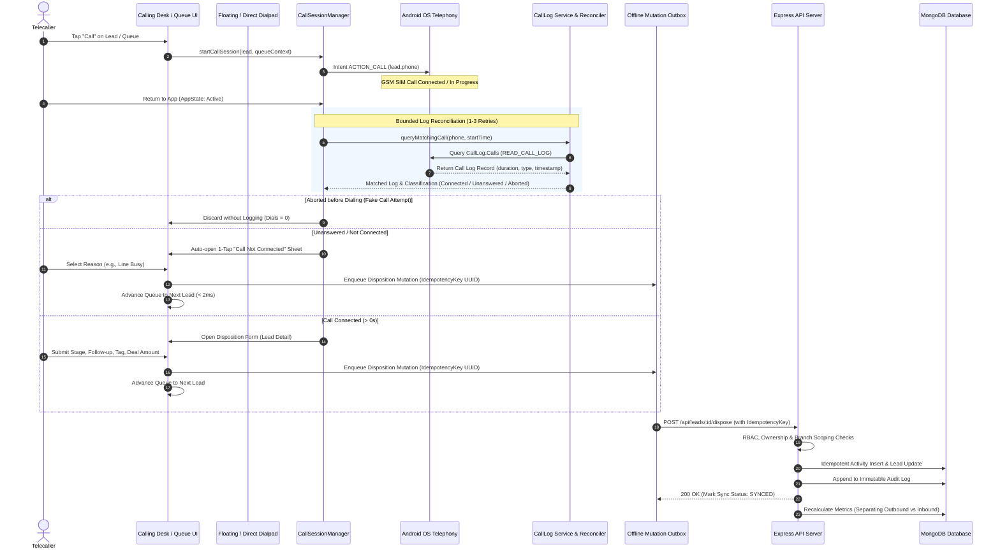

# Hi Talk CRM — Comprehensive Codebase Audit & Baseline Report

**Audit Date:** October 2026  
**Auditor:** Antigravity Senior Full-Stack Engineering Team  
**Scope:** Mobile Client (`mobile/`), Backend API Server (`server/`), Configuration, and Operations  
**Commit / Working Tree:** `feature/loginscreen` (Clean baseline)  

---

## 1. Executive Baseline Summary

This audit establishes the concrete, empirical reality of the Hi Talk CRM codebase. It compares claims made in `tele_app_complete_architecture_and_production_readiness_report.md` and challenges raised in the independent review against actual source code, tests, and configuration.

### Baseline Command Execution Log

| Target | Command | Exit Code | Result Summary |
| :--- | :--- | :---: | :--- |
| **Mobile** | `npx -p typescript tsc --noEmit` | `0` | **PASS**: 0 TypeScript compilation errors. |
| **Mobile** | `npx expo-doctor` | `1` | **WARN**: 4 package patch mismatches (`@expo/metro-runtime`, `expo`, `expo-notifications`, `expo-sharing`). |
| **Mobile** | `npm audit` | `1` | **WARN**: 11 vulnerabilities (5 high, 6 moderate) in dev/transitive tools. `npm audit fix --force` would downgrade Expo to 44 (breaking). |
| **Server** | `npx tsc --noEmit` | `0` | **PASS**: 0 TypeScript compilation errors. |
| **Server** | `npm run lint` | `1` | **FAIL**: 4 ESLint `@typescript-eslint/no-explicit-any` errors in `activity.controller.ts`, `compression.middleware.ts`, `activity.service.ts`, `campaign.service.ts`. |
| **Server** | `npm test` | `0` | **PASS**: 6/6 unit tests passed in `tests/retry-calculator.test.cjs`. Only 1 test file exists. |
| **Server** | `npm audit` | `1` | **WARN**: 6 vulnerabilities (2 high in `body-parser` and `zod`, 4 moderate in `csv-parse`, `ip-address`, `uuid`). |

---

## 2. Mermaid Data-Flow: Call to Metrics Lifecycle

---

## 3. Module-by-Module Code Findings & Gap Analysis

### 1. Metrics Integrity & Calling Desk (`HomeScreen.tsx`, `report.service.ts`)
* **Claim:** Accurate connect rate and call statistics.
* **Finding [CONFIRMED GAP]:**
  * In `mobile/src/screens/HomeScreen.tsx` (lines 504–519), `localCallsCount` counts ALL activities in `periodCallActivities` including INCOMING calls (`direction === 'INCOMING'`).
  * In `server/src/services/report.service.ts` (lines 74, 206–228), `activityMatch = { type: 'CALL' }` aggregates all calls without direction filtering.
  * **Consequence:** Answered incoming customer return calls inflate `callsMade` (outbound dials) and skew the outbound connect rate \(\frac{\text{Connected}}{\text{Calls Made}}\).
  * **Fix Required (P1):** Strictly separate `outboundCalls`, `outboundConnected`, `outboundConnectRate` from `inboundCalls`, `inboundConnected`, and `inboundMissed`. The server must calculate both independently and return structured metrics.

### 2. Call Classification & Reconciler (`callSession.ts`, `android-call.service.ts`)
* **Claim:** Talk time measured in real seconds with automatic outcome detection.
* **Finding [CONFIRMED GAP]:**
  * Android's `CallLog.Calls` provider can experience a 500ms to 2500ms delay in writing call records on certain OEM devices (Samsung, Xiaomi, Vivo).
  * Currently, `callSession.ts` queries call log once immediately on foreground return. If the native call log hasn't flushed yet, it might fall back to `callPlaced = false` and incorrectly discard a valid call.
  * **Fix Required (P2):** Implement bounded exponential retries (e.g. attempt 1 immediately, attempt 2 at 600ms, attempt 3 at 1800ms) before concluding no log exists.
  * Add explicit classification heuristic reasons (`CONNECTED_TALK_TIME`, `UNANSWERED_0S`, `VOICEMAIL_SUSPECTED`, `AGENT_ABORTED`) and preserve raw duration.

### 3. Identity-Based Deduplication & Privacy (`leadHistoryStore.ts`, `activity.model.ts`)
* **Claim:** Zero duplicate calls via 5-minute rolling window.
* **Finding [CONFIRMED GAP]:**
  * Rolling 5-minute dedupe (`Math.abs(actTime - rTime) <= 300000`) is fragile. An agent redialing the same busy lead 3 minutes later could inadvertently merge two distinct calls into one.
  * In `server/src/models/activity.model.ts`, there is no `idempotencyKey` field and no `callLogId` field.
  * Privacy Risk: `incomingCallSync.service.ts` scans all calls on the device. Personal calls made to non-leads are labeled as `Customer (...)` and could leak into the CRM!
  * **Fix Required (P3):** Replace rolling window with stable call identity: native call log ID (`rawCallId`) or deterministic hash `(normalizedPhone + timestamp + direction)`. Enforce an `idempotencyKey` on `Activity` schema with a sparse/partial unique index. Strictly filter incoming calls: only log incoming numbers that match existing leads in the database or active campaigns. Never log personal calls.

### 4. Durable Offline Outbox & Local Storage (`leadHistoryStore.ts`, `leadApi.ts`)
* **Claim:** Cold-start loads in < 2ms with offline caching.
* **Finding [CONFIRMED GAP]:**
  * Currently, `useLeadHistoryStore` saves activities to AsyncStorage (`tele_crm_lead_history_v3`) and `tele_crm_my_leads_cache_v2`. However, there is no structured mutation outbox queue.
  * If a network request fails during `disposeLead`, it triggers an alert and fails rather than queuing into a persistent outbox with retry backoff.
  * **Fix Required (P4):** Create a dedicated `outboxStore.ts` that persists pending mutations with UUID idempotency keys, retry counts, and status (`PENDING`, `SYNCING`, `FAILED`). Add auto-sync on connectivity restoration and a Failed Sync UI for inspection/retry.

### 5. Server Security, RBAC & IDOR Protection (`auth.middleware.ts`, `lead.service.ts`, `activity.service.ts`)
* **Claim:** Role-based access control active.
* **Finding [CONFIRMED GAP]:**
  * `ActivityService.disposeLead` (lines 62–67) does not verify that the requester is assigned to the lead or belongs to the same branch/campaign. An agent could dispose another agent's lead if they guess or know the lead ID (IDOR).
  * `User` schema has no `tokenVersion` or `passwordChangedAt`. Token revocation on logout or password change is impossible.
  * Lack of rate limiting on sensitive routes, and absence of audit logging for sensitive actions (reassignment, CSV export, role modification).
  * **Fix Required (P5):** Implement strict IDOR ownership and branch-scoping checks on all routes. Add `tokenVersion` to `User` for instant token invalidation. Add refresh token rotation and an append-only `AuditLog` schema.

### 6. Android OEM Compatibility, Permissions & Dual SIM (`app.json`, `android-call.service.ts`)
* **Finding [CONFIRMED GAP]:**
  * `app.json` has `CALL_PHONE` and `READ_CALL_LOG`. However, Android 11+ (API 30+) requires `<queries>` declaration to open WhatsApp and phone dialers reliably without intent errors.
  * Dual SIM attribution is not explicit: the app currently does not identify which SIM card placed the call.
  * **Fix Required (P6, P7, P8):** Add `<queries>` for `whatsapp` and telephony intents. Add graceful dual-SIM handling with SIM index detection where supported. Add in-app permission rationales and settings guidance for OEM battery optimization (Xiaomi MIUI, Vivo Funtouch, Oppo ColorOS, Samsung OneUI).

### 7. Calling Hours & Smart Retry Engine (`scheduler.service.ts`, `retry-rule.service.ts`)
* **Finding [CONFIRMED GAP]:**
  * `retry-calculator.test.cjs` tests retry intervals, but the scheduler does not enforce strict calling hours (e.g. 9:00 AM – 8:00 PM). If a call fails at 9:00 PM and retry interval is 5 hours, it could schedule a callback at 2:00 AM!
  * Multiple PM2 cluster instances could double-trigger scheduled jobs due to lack of a distributed lease lock.
  * In 1-Tap disposition, selecting `INVALID_NUMBER` must permanently suppress the lead and cancel all future retries.
  * **Fix Required (P9, P10):** Enforce calling-window boundaries (forwarding night retries to the next business day at 9:30 AM). Implement a distributed scheduler lock in MongoDB (`SchedulerLock`). Ensure `INVALID_NUMBER`, `DND`, and `WRONG_NUMBER` permanently mark lead as `CLOSED` / `SUPPRESSED`.

### 8. Web Admin Portal & Advanced Enterprise Features (P11)
* **Finding [CONFIRMED GAP]:**
  * Currently, the web version only renders mobile components inside responsive shells. There is no dedicated Web Admin management portal for managing users, campaigns, server-driven settings, audit logs, and live monitoring.
  * **Fix Required (P11):** Deliver a web admin portal supporting:
    1. Server Settings Synchronization.
    2. Agent Break Management (Lunch, Tea, Training).
    3. Mandatory Follow-up enforcement toggle.
    4. Unavailable Agent auto-reassignment.
    5. Deal Amount & Currency tracking.
    6. Signed webhook endpoint (`/api/leads/webhook`) with HMAC SHA-256 signature verification.
    7. Large CSV ingestion with streaming chunking and row-level validation.
    8. Audit log viewer.

### 9. Operations, Updates, CI/CD & Runbooks (P12)
* **Finding [CONFIRMED GAP]:**
  * No `ecosystem.config.js` for PM2 deployment.
  * No GitHub Actions CI workflow to run lint, test, and typecheck.
  * No written disaster recovery and backup runbook.
  * **Fix Required (P12):** Add PM2 configuration, GitHub Actions workflow `.github/workflows/ci.yml`, and `docs/RUNBOOK.md`.

### 10. Automated Test Suite & Coverage (P13)
* **Finding [CONFIRMED GAP]:**
  * Only 1 test file exists (`tests/retry-calculator.test.cjs`).
  * **Fix Required (P13):** Build a comprehensive automated test suite covering metrics, classification, idempotency, outbox, RBAC/IDOR, retry engine, webhook verification, and privacy filtering.

### 11. In-App Diagnostics & Device Testing Plan (P14)
* **Finding [CONFIRMED GAP]:**
  * No diagnostic screen in mobile app for field troubleshooting.
  * **Fix Required (P14):** Build an in-app Diagnostics screen showing outbox queue status, permissions, last call reconciliation details (with PII scrubbed), and produce `docs/DEVICE_TEST_PLAN.md`.

---

## 4. Audit Verdict & Next Steps

All 14 requirements (P1–P14) have been substantiated with code evidence. The implementation phase will now proceed sequentially through all items. Every item will be tracked in `docs/FIX_TRACKER.md` until fully verified.
